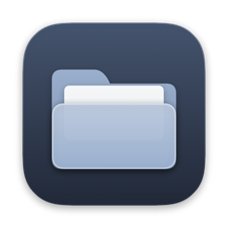
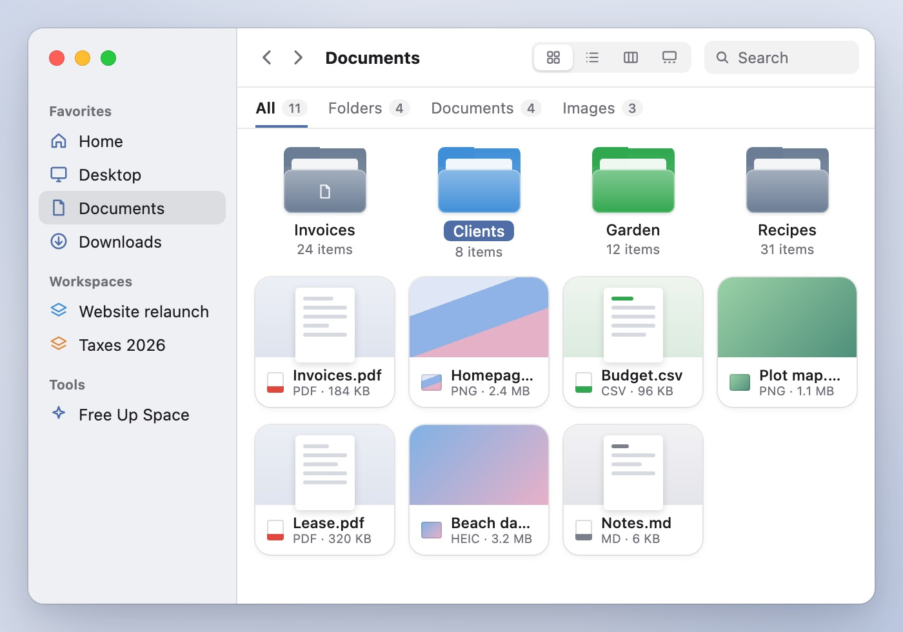
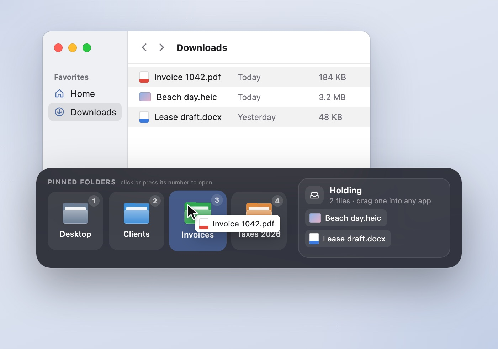
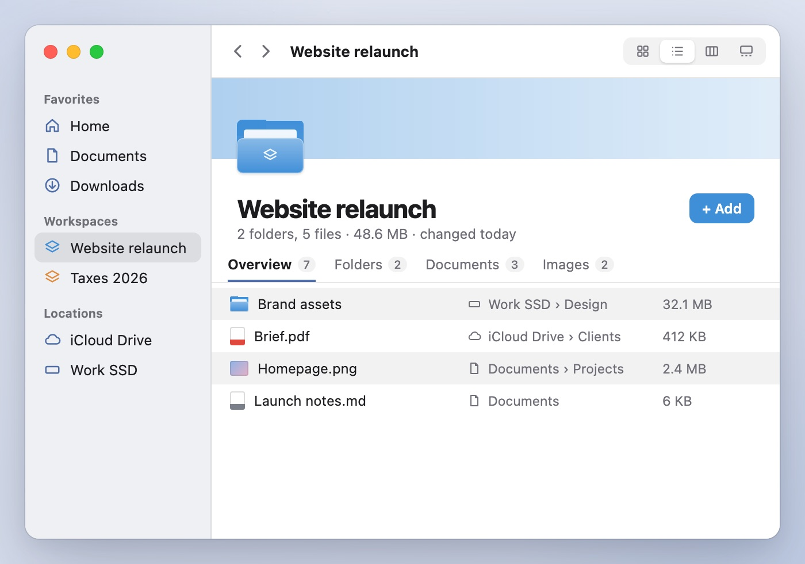
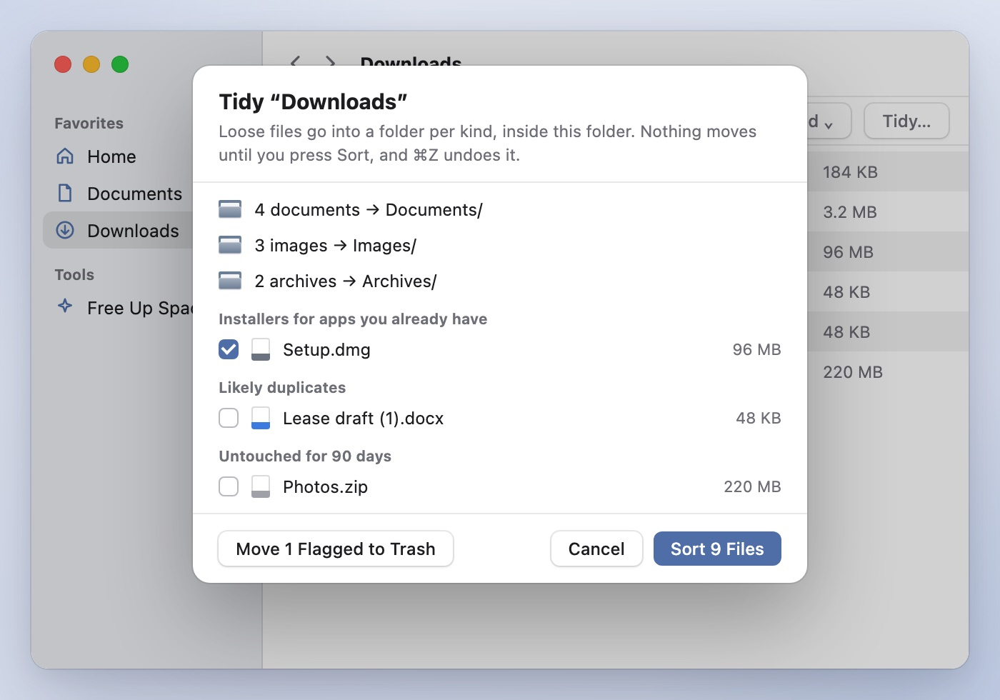
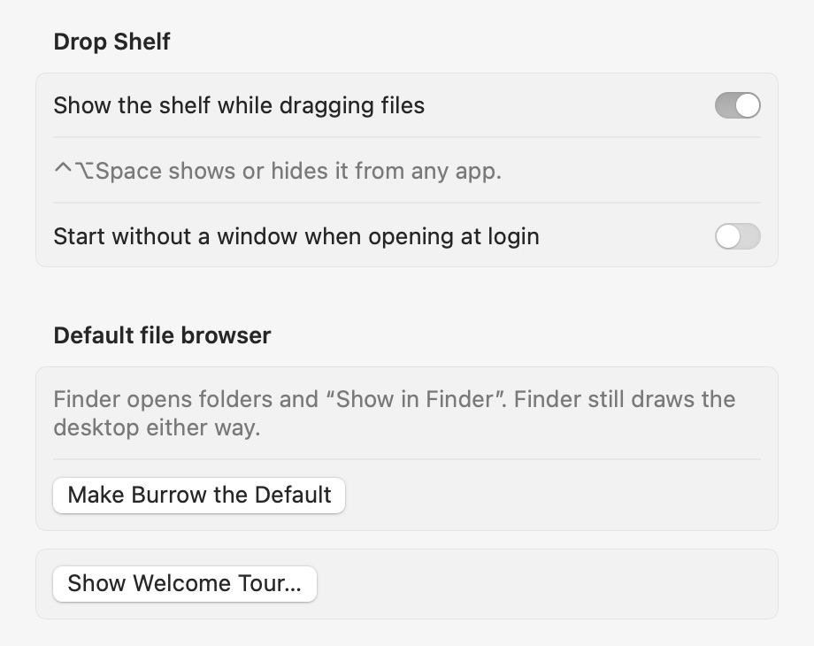

<div align="center">



# Burrow

A Finder replacement for macOS: columns, list, icons and gallery with tabs and a split view,<br>
a Drop Shelf for moving files between apps, workspaces, and a tidier Downloads folder.

[](https://newitools.app/burrow/)
[](https://github.com/andrewneuwirth/burrow/releases/latest)
[](https://github.com/andrewneuwirth/burrow/actions/workflows/ci.yml)
[](Package.swift)
[](LICENSE)

[**Download**](https://github.com/andrewneuwirth/burrow/releases/latest) · [Website](https://newitools.app/burrow/) · [Privacy](PRIVACY.md)

<br>

<picture>
  <source media="(prefers-color-scheme: dark)" srcset="docs/views-dark.jpg">
  
</picture>

</div>

## Features

| Four views | Drop Shelf | Workspaces |
| --- | --- | --- |
| Icons, list, columns (⌘3) and gallery, with tabs, a split view (⌘D; F5 copies and F6 moves to the other side), Quick Look on Space and ⌘K to jump to any folder. | ⌃⌥Space from any app, or by itself while you drag files. Drop on a pinned folder to move a file there (⌥ copies), or keep files in Holding for later. | A project's files and folders from anywhere (your Mac, iCloud Drive, external drives) on one page. Nothing is copied or moved. |
| **Smart Downloads and Tidy** | **Free Up Space** | **Undo for everything** |
| Group by kind or date, sort into kind folders, and flag installers you already installed, duplicates and files untouched for 90 days. Flagged files only go to the Trash. | Caches, old downloads, Mail attachments and more, each explained, everything to the Trash. | Rename, move, copy, new folder and Trash all undo with ⌘Z. |
| **Default file browser** | **Developer tools** | **No server** |
| Optional: folders and every app's "Show in Finder" open in Burrow. One click gives it back to Finder. | Off for new installs: an AI Agents page, Installed packages, Xcode build files in Free Up Space, `~/Developer` in the sidebar. | SwiftUI and AppKit, running entirely on your Mac. Bookmarks and About This Mac pages too. |

## Screenshots

<table>
<tr>
<td width="50%"><picture><source media="(prefers-color-scheme: dark)" srcset="docs/shelf-dark.jpg"></picture><br><sub>The Drop Shelf</sub></td>
<td width="50%"><picture><source media="(prefers-color-scheme: dark)" srcset="docs/workspace-dark.jpg"></picture><br><sub>A workspace gathers files from anywhere</sub></td>
</tr>
<tr>
<td width="50%"><picture><source media="(prefers-color-scheme: dark)" srcset="docs/tidy-dark.jpg"></picture><br><sub>Tidy for Downloads</sub></td>
<td width="50%"><picture><source media="(prefers-color-scheme: dark)" srcset="docs/default-dark.jpg"></picture><br><sub>Make Burrow the default, in Settings</sub></td>
</tr>
</table>

## Install

Download `Burrow-0.1.0.dmg` from [Releases](https://github.com/andrewneuwirth/burrow/releases/latest), open it and drag
Burrow to Applications. It's signed with Developer ID and notarized by Apple, updates itself, and needs macOS 15 or later.

### Build from source

Needs Xcode 26 or later (Swift 6.2 tools); the app runs on macOS 15 or later.

```sh
git clone https://github.com/andrewneuwirth/burrow.git Burrow && cd Burrow
swift build && .build/debug/Burrow --self-check   # should print "Burrow self-check passed"
./build.sh                                        # makes build/Burrow.app
open build/Burrow.app
```

Burrow uses MacToolsUpdates from [mac-tools-kit](https://github.com/andrewneuwirth/mac-tools-kit); SwiftPM fetches it, or
uses a checkout at `../Kit` if you have one. `build.sh` signs with your Apple Development identity if you have one (a
stable signature keeps the Desktop, Documents and Downloads grants across rebuilds), otherwise ad hoc. To use your own
bundle id or signing identity, copy `config.example.env` to `config.local.env` and edit it.

## Making it the default, and going back

Settings › Make Burrow the Default (or the walkthrough) sets the `NSFileViewer` default, so every app's "Show in Finder"
opens in Burrow, asks Launch Services to open folders with it, and turns on Open at Login so the shelf's shortcut is
always there. **Give It Back to Finder** in the same place (or Burrow › Give It Back to Finder…) undoes all
three. Settings › Start without a window keeps login launches quiet: just the shelf and its shortcut. From Terminal:

```sh
/Applications/Burrow.app/Contents/MacOS/Burrow --make-default
/Applications/Burrow.app/Contents/MacOS/Burrow --give-back
# or by hand: defaults delete -g NSFileViewer
```

macOS may still hand some plain folder opens to Finder; "Show in Finder" requests always come to Burrow.

## Uninstalling

1. If Burrow is your default file browser, choose **Burrow › Give It Back to Finder…** (also in Settings), or run
   `/Applications/Burrow.app/Contents/MacOS/Burrow --give-back`. Skipping this leaves "Show in Finder" pointing at a
   missing app; `defaults delete -g NSFileViewer` fixes it afterwards.
2. If you turned on Open at Login yourself, turn it off in System Settings › General › Login Items (Give It Back does
   this for you). Then quit Burrow and move it to the Trash.
3. Optional, to remove its settings and files:

```sh
defaults delete app.newitools.Burrow
rm -rf ~/Library/Application\ Support/Burrow   # bookmarks and the shelf's Holding list
```

## Permissions

Desktop, Documents and Downloads (macOS asks once for each), external and network drives when you open them, and
Automation for your browser the first time you use Add Bookmark. Full Disk Access is optional: it removes the prompts and
lets Free Up Space measure Library folders. The walkthrough shows what's on.

## Privacy

Burrow runs entirely on your Mac and collects nothing. It only goes online for web pages you bookmark (to read their title
and preview image) and images inside Markdown files you open. Full policy: [PRIVACY.md](PRIVACY.md).

## Contributing

See [CONTRIBUTING.md](CONTRIBUTING.md). Security issues: [SECURITY.md](SECURITY.md).

## License

[MIT](LICENSE). Burrow is part of [newi tools](https://newitools.app/burrow/).
